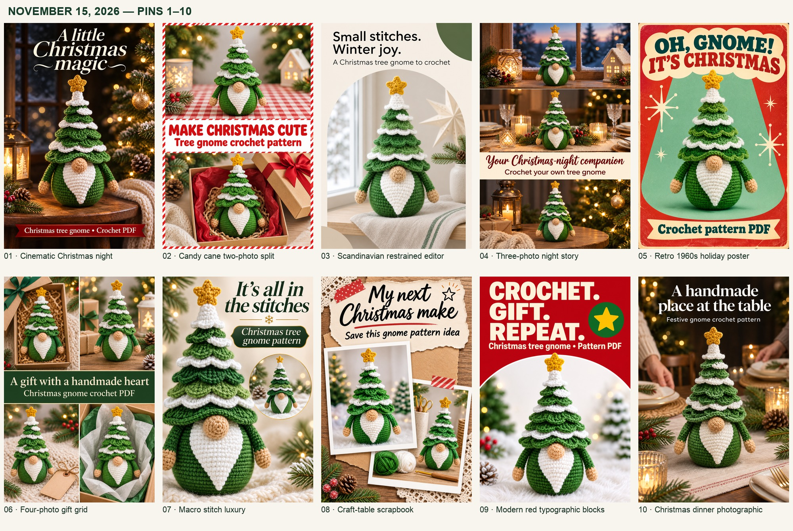
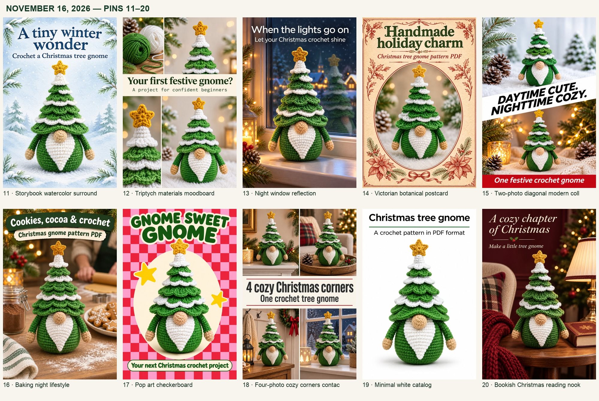
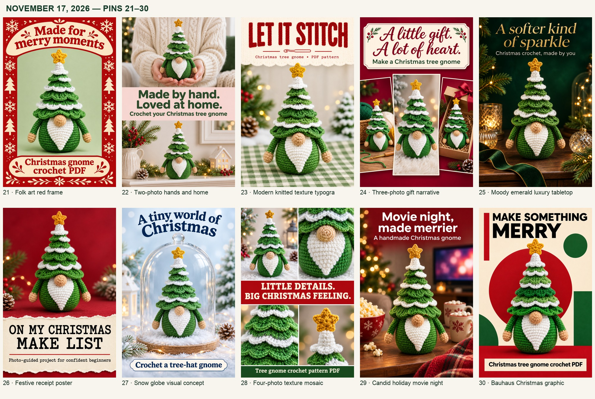
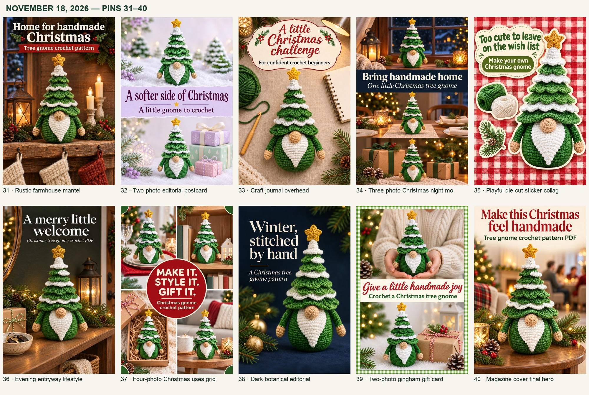

# Christmas crochet Pinterest campaign

40 different image pins and a Pinterest bulk-upload CSV. This repository hosts the public images used by the CSV.

## Upload

1. Download **pinterest-bulk-upload.csv**.
2. In your Pinterest business account on desktop, open **Settings → Import content → Upload .csv or .txt file** and upload the CSV.
3. Review Pinterest's processing confirmation and the imported schedule. This repository does not publish or schedule anything by itself.

## Schedule

**November 15–18, 2026. Ten pins per day. Africa/Casablanca time (UTC+0 on these dates).**

November 15 uses the remaining evening: 20:00, 20:24, 20:48, 21:12, 21:36, 22:00, 22:24, 22:48, 23:12 and 23:36. November 16–18 use 08:00, 09:30, 11:00, 12:30, 14:00, 15:30, 17:00, 18:30, 20:00 and 21:30. CSV timestamps use UTC, as Pinterest requires; UTC matches Morocco local time on these dates. Upload before 20:00 Morocco time on November 15; if uploading later, move past timestamps into the future first.

Board names: Christmas Crochet Patterns; Crochet Christmas Decor; Handmade Christmas Gifts; Amigurumi Gnome Patterns. Pinterest documents that missing boards or sections are created during import, so edit these names first if you want to use different existing boards.

All 40 destination links use the supplied Etsy listing. Four pins (4, 14, 24 and 34) use longer titles and descriptions, within Pinterest's 100-character title and 500-character description limits. Five pins (12, 19, 26, 33 and 39) mention confident beginners. No account name appears in pin copy or visible artwork. No invented engagement statistics or free-pattern claims are included.

## Images

### Preview the 40 pins

Each PNG is a distinct 2:3 vertical creative. The mix includes photographic lifestyle scenes, two-, three- and four-photo collages, center text panels, candy-cane frames, scrapbook layouts, macro detail, pastel, retro, folk, minimal and editorial designs. The images were generated and refined with imagegen using the supplied crochet guide's gnome as the reference; they are styled visualizations rather than documentary product photographs. Shape, stitch texture, colors and lighting were polished at the owner's request. Actual crochet results depend on materials and technique.

Only marketing images and campaign metadata are public here. The paid PDF pattern is not included. Keep this repository public and the image files available while Pinterest imports them.

## Files

- images/: 40 final PNG files.
- previews/: four visual contact sheets.
- pinterest-bulk-upload.csv: the upload file; eight official columns, one pin per row.
- pin-manifest.json: pin IDs, styles and both local and UTC timestamps for review.

## References checked November 15, 2026

- [Morocco official time reference](https://siamaroc.onda.ma/eaip/GEN/GEN2.1.pdf) — UTC, confirmed against the system Africa/Casablanca time-zone database.
- [Pinterest bulk-upload format](https://help.pinterest.com/en/business/article/bulk-upload-video-pins)
- [Pinterest creative guidance](https://business.pinterest.com/creative-best-practices/) — vertical 2:3 images, clear overlays and product-led real-life settings informed the designs. These are creative tests; no particular style is represented as proven to generate views.
- [Product destination](https://sweetcozycrochet.etsy.com/listing/4617884677/crochet-christmas-tree-gnome-pattern-pdf) — supplied by the owner; Etsy's device check prevented independent inspection, so product visuals and construction were based on the supplied guide.
